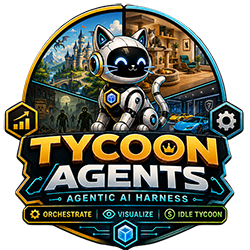
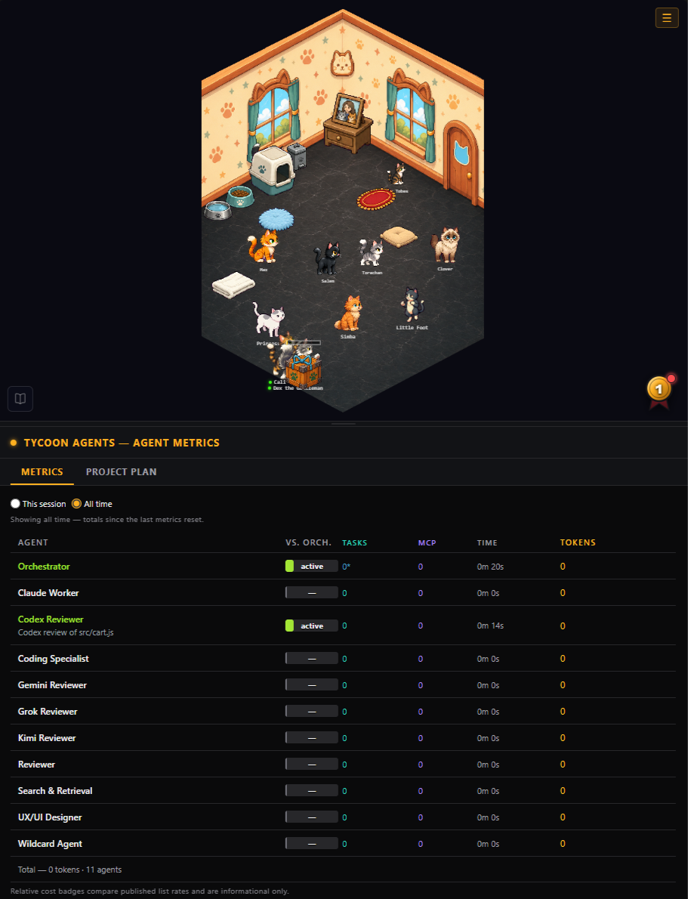

# TycoonAgents™

**TycoonAgents™ is an AI build harness first, and a visualization second.** It's built to make the most of your tokens: instead of running everything on one expensive model, it routes work to a fleet of sub-agents — each on the model that fits the job — so your project gets built in the most cost-effective way possible. A heavyweight model coordinates and makes the calls; cheaper, faster models pick up the work they're suited for.

Sitting on top of that harness is a live, game-style visualization of your agent fleet — but the harness is the point. Built for solo developers and small teams working on indie/UGC games and web apps.

Themes: download official theme packs from [tycoonagents-themes](https://github.com/Corsair-Studios/tycoonagents-themes).

**Features at a glance**
- Mandatory delegation: the orchestrator coordinates, specialist sub-agents do the work.
- Multi-model delegation through the TycoonAgents dispatcher, with per-agent routing and automatic fallback chains.
- Live visualization and per-agent token-cost metrics.
- Tycoon Theme Builder for custom stage art; Project Plan with approval gates (on by default).
- VS Code extension or standalone app; an in-panel handbook covers everything in depth.

Tested on Windows. macOS and Linux support is experimental.

**How sign-in works:** TycoonAgents uses your installed Claude Code, Codex and Antigravity command-line tools under their own sign-in — it never reads, stores or forwards your credentials. The panel itself makes no AI calls; theme generation is a separate opt-in service. OpenAI-compatible endpoints use an endpoint URL/API key you set, stored per user outside your project (never in it).

> **Status:** Working prerelease — not a design sketch. TycoonAgents ships as a real VS Code extension (.vsix) with a small early user base: mandatory delegation, the live visualization, custom themes, an in-panel handbook, and everything else described below runs today. It's still prerelease software — expect rough edges and breaking changes between versions. See [docs/DESIGN.md](docs/DESIGN.md) for the full product & architecture design.

**Ways to run it:**
- **VS Code extension with Claude Code** — install the extension and open the panel (see Setup below).
- **Standalone app** — `node standalone/src/cli.mjs watch .`, no VS Code required; see [`standalone/README.md`](standalone/README.md).
- **Codex (Experimental) as the harness** — `--provider codex`; see "Multi-LLM" below.

## Mandatory delegation & orchestration

TycoonAgents installs a **delegation doctrine** into your project's `CLAUDE.md` and a roster of specialist sub-agents into `.claude/agents/`. The rule it establishes is simple: **the orchestrator coordinates work — it does not do the work.** Implementation, searching, and exploration are all delegated via the Task tool to the specialist best suited to each job. Doing that work directly on the orchestrator's model costs **many times more per token when the orchestrator is Opus** — more in practice, since the orchestrator re-reads its large context every turn (less if you've configured a cheaper orchestrator model) and hides the work from the visualization.

The default roster the extension seeds (all model tiers are configurable):

| Agent | Model | Handles |
| --- | --- | --- |
| **orchestrator** | Opus or higher (recommended) | Coordinates and delegates; never implements directly |
| **search-retrieval** | Haiku | File/code search, grep/glob, lookups — the cheapest tier |
| **coding-specialist** | Sonnet | Implementation, edits, bug fixes, refactoring |
| **testing-specialist** | Sonnet | Tests, specs, coverage |
| **ux-ui-designer** | Sonnet | Layout, CSS, canvas, animation, accessibility |
| **reviewer** | Sonnet | Generic code review pass (code projects; withheld in UEFN projects, where `uefn-auditor` is the gate) |
| **uefn-auditor** | Sonnet (UEFN pack) | Reviews UEFN Verse for correctness, deprecations, and API compliance against the locally installed Verse/Fortnite/Unreal digests — does not author features |
| **verse-expert** | Sonnet (UEFN pack) | Writes and refactors UEFN Verse device scripts and island gameplay, using the UEFN Bridge for live-editor control |
| **Wildcard Agent** | Sonnet | Catch-all for work no specialist keyword matched — a signal to refine routing, not a design goal |

Code projects get search-retrieval, the Wildcard Agent, coding-specialist, testing-specialist, ux-ui-designer and reviewer. UEFN projects get search-retrieval and the Wildcard Agent plus the UEFN pack's verse-expert and uefn-auditor. The Playwright QA pack adds web-qa. Specialists such as vscode-integration and workspace-monitor are not part of the default roster.

The doctrine also builds in **verification discipline**: a "completed" notification is not proof, so the orchestrator reads changed files on disk before trusting a result, keeps concurrent workers on disjoint files, and treats workers as leaves that do the work themselves rather than re-delegating.

## Token savings you can see

Because searches run on Haiku and implementation on Sonnet instead of everything on the orchestrator's (recommended: Opus or higher) model, most of your work is routed to models that are cheaper and better suited to each job — **many times cheaper** per token. The panel shows the live ratio for your configured models. The metrics panel makes that concrete, without pretending to be a billing statement:

- **Per-agent "vs. orch." badge** — a ratio such as *"N× cheaper"* (or *"N× pricier"*) appears only for metered agents on the same vendor as the orchestrator. Subscription agents show *Sub*, local ones show *Local*, and other-vendor agents show their billing type (API).
- **Cost-share bar** — each agent's row fills in proportion to its estimated share of the run's blended cost, so you can see at a glance where the spend went.
- **Session headline** — *"Delegating this work avoided ~N% of the cost of running it all on the orchestrator."* Shown only when delegation was actually cheaper, and only for same-vendor metered agents.

**When the ratio isn't shown.** The relative-cost line only appears when every delegated worker in the run shares one vendor with a shipped price table and reported real token usage. In mixed-vendor setups — say a Codex, Gemini, or Kimi reviewer alongside Claude workers — or when a worker returns no usage at all, the panel shows *"Relative cost not shown: <reason>"* instead; per-agent token and call counts still display. Separately, because TycoonAgents delegation spawns Claude Code subagents, VS Code's own Agent map also lists them — the two views agree only in a pure Claude setup, since foreign-harness workers never appear in the Agent map.

**What the Tokens column counts.** The Tokens column is billed context tokens summed over every turn — input, output, and cache writes — with cache reads shown separately since they aren't billed at the same rate. Harnesses that don't report usage (Codex today) show *"n/a"* and are left out of the total.

**Concurrent spawns of the same specialist.** When more than one instance of a specialist is live at once, the metrics table tracks each spawn separately: the row picks up a **"×N"** badge and an extra character appears on the scene for as long as more than one instance is running. The active row shows the spawn's task description under the agent name, matching the label used in the VS Code Agent map. An **"(inferred)"** marker next to the name means the spawn used a built-in subagent type rather than an explicit agent name, so the role shown was guessed from keywords in the brief — treat it as a cue to tighten keyword routing or name the agent directly.

Figures are **dimensionless ratios** from measured tokens × approximate per-model rates — the price table only drives these relative "N× cheaper" badges, and no dollar amount is ever shown, since that would misrepresent subscription plans (which bill by plan, not per token). The point is the *ratio*: the same work on a bigger model would cost multiples more.

## Project plan

Turn a design doc into an **approvable plan** and let the fleet execute it. The Project Plan feature decomposes a spec into an ordered set of **phases**, each holding **tasks** with concrete acceptance criteria, then works through them one task at a time — delegating each to the right specialist, verifying the result against its own criteria, and **stopping at every phase gate for your approval** before moving on.

All the reasoning happens in Claude Code; the extension only reads and displays `.claude/tycoon/plan.json` and lets you approve, retry, or skip tasks from the panel (see "Self-contained & hook-driven" below). It's **on by default** for new installs and toggleable in Settings.

## Self-contained & hook-driven

The panel itself makes **no AI calls.** Model calls go only through the CLIs and servers you configure (relays and the dispatcher forward your briefs to them). The only optional network features are theme generation (the hosted Theme Service) and the Routing view's "Test connection". Everything you see is built from **hooks** that record when agents are dispatched, work, and finish, captured by whichever harness is installed (Claude Code or Codex (Experimental)). The visualization and metrics are a normalized view of those records, nothing more.

## Setup

Install the extension and open the TycoonAgents panel. First run (or the **Repair** button) sets everything up in your project:

- writes the delegation doctrine into `CLAUDE.md` (in a managed, auto-healing block),
- seeds the specialist agent roster into `.claude/agents/`,
- merges the tracking hooks into `.claude/settings.local.json`,
- enables the Project Plan by default.

Everything it writes is marker-scoped and reversible, and it never stamps your own generated code.

In a new project, first-run setup then shows a **Reload Window** button so Claude Code loads the new agents. When agents are added to an existing project, starting a new Claude chat is enough.

## What's shipped

- **Bundled theme.** "Catopia" (the default) and "Doggo Tycoon" ship inside the VSIX and seed automatically on first run, so a fresh install has a playable stage out of the box.
- **Tycoon Theme Builder.** Opened from the **Tycoon Themes** menu, this is the primary path for building a theme (characters, objects, enemies, expressions, badges, decor, and an environment) and opens straight to the draft form from every entry point. Name your theme once, then choose **Generate with AI** — which fills a plan you always review and edit before any images generate, with an optional pause for your approval after each image — or **Build manually**, which goes straight to the sprite boards. Every board card shows its name and description for editing alongside the usual Retry, edit-direction, Normalize size, Upload, Keep, and Reslice controls; on the manual path, a board without an image can still be generated individually with AI once you sign in. **Save theme** saves the whole theme, and it also saves automatically after every upload.
- **Import .zip.** The free, offline path, and always available: additional themes are published as `.zip` archives. Download official theme packs from the [tycoonagents-themes](https://github.com/Corsair-Studios/tycoonagents-themes) repo, then import the `.zip` from the Theme Picker's **Import .zip**. The extension never fetches themes over the network.
- **In-panel handbook.** A 15-chapter user handbook ships in the VSIX, opened from the book icon in the panel. It is the place to go for depth on setup, themes, routing, and fallback.
- **Submit Feedback.** An in-panel two-step form shows the exact JSON payload before anything is sent; local paths and API keys are stripped from it first. If the panel won't open, there's a fallback web form at [feedback.corsairstudios.com](https://feedback.corsairstudios.com).
- **Delegation & Metrics tabs.** Live panel views of what got delegated to which agent and the resulting token-cost breakdown (see "Token savings you can see" above).
- **UEFN pack.** See "UEFN pack" below.
- **Verse analyzer.** Audits UEFN Verse source against the locally installed Verse/Fortnite/Unreal API digests, flagging calls to deprecated or nonexistent APIs.
- **UEFN moderation pre-flight scan.** Collects the asset names, paths, and metadata Fortnite's island moderation actually inspects, then has your connected AI assistant judge them against Epic's IP and authenticity rules before you submit.
- **Ready test & diagnose, by default.** The `tycoon-ready-test` skill (spawns every configured agent in parallel and verifies they light up in the visualization) and `tycoon-diagnose` skill (AI-reasoned audit of this project's own delegation/routing config) both ship in the VSIX and land in `.claude/skills/` on every Install/Repair — no separate opt-in.

## The layer on top: the tycoon visualization

The fun part — a game-style scene that makes agent activity readable at a glance:

- **Live per-agent metrics** — who's active, work completed, token cost, tasks finished, response rate, MCP usage.
- **Build & defend** — agents build objects across your site and defend the base from incoming attacks.
- **Achievements, badges & rebirths** — earn badges for milestones; rebirth for compounding bonuses (and the whole fleet dances for three seconds when you do).

The Agents screen defaults to a single-provider view with per-agent model tier radios for the provider your harness runs on (Claude: Fable, Opus, Sonnet, Haiku; Codex: Astra, Sol, Luna). Turn on **"I use more than one AI provider"** in Settings (`tycoonagents.agents.multiProvider`, per user) to show the full vendor and fallback controls; the standalone host always shows the full view.

The Agents screen's **Keyword health** card flags routing problems in `agent-keywords.json` (dangling refs, multi-word segments that can never match, an agent listed after the Wildcard Agent) and offers a **Fix all** to normalize them. See [`docs/keyword-routing.md`](docs/keyword-routing.md) for how Task routing scores keywords.

## Custom themes

The scene is **user-authored data** — you can generate your own theme (characters, objects, enemies, expressions, badges, decor, and an environment) from text prompts.

1. **Open the Theme Builder** from the Themes panel — it's the primary path for creating a theme.
2. **Choose a model.** Pick a generation model — it defaults to **Latest (recommended)** and offers older/cheaper tiers if you'd rather save cost. Generation runs through the Corsair Theme Service using credits (see "Sign-in and credits" below).
3. **Fill the generate form** — theme name, creative direction, and an environment description, plus per-slot editors for the characters (16), objects (21), enemies (4), expressions (8), badges (25), and decor (9).
4. **Generate and review.** Each sprite board is generated in turn; a review list lets you rename items, edit descriptions and creative direction, and **accept or retry** each board until it's right.
5. **Use it.** Themes are stored in the extension's global storage and loaded into the live scene at runtime; you can **export a theme as a `.zip`** and import it elsewhere.

Character boards get a walk pose guide (two-legged or four-legged, chosen per character with the Body control) attached by the service as a reference image so row 1 walk frames stay consistent, at no extra credit cost.

Changing the creative direction after descriptions already exist marks them stale; use **Re-derive descriptions** to regenerate the text before generating or retrying images. See the [GitHub releases page](https://github.com/Corsair-Studios/TycoonAgents/releases) for what changed in recent versions.

Prefer to author outside VS Code? There's a **standalone theme host** in [`standalone/`](standalone/) that drives the same generation pipeline in a browser tab — `npm start` for a dev server, or, from the `standalone/` folder, `node src/cli.mjs watch <project-path>`.

> Image generation happens **only at authoring time**, through the Corsair Theme Service (see "Self-contained & hook-driven" above) — themes are just data.

### Prompt tips

- State the **subject** plainly first (what the character/object/enemy is), then style — the model reads left to right.
- Pin down an **art style** (e.g. "flat vector," "painterly pixel art," "clean cel-shaded") and repeat it across boards so the whole theme reads as one set.
- Name an explicit **palette** (2-4 colors) rather than leaving color to chance — it's the fastest way to keep sprites from clashing.
- Favor a strong, readable **silhouette** — sprites render small on the stage, so shape and contrast matter more than fine detail.
- Lock a consistent **camera/side view** (e.g. "3/4 side view, facing right") across every character and enemy board so the set feels like one game.
- Say what to **avoid**: no embedded text, no logos or watermarks, no background scenery, and no more than one character per cell.
- Keep descriptions **short and concrete** — a cluttered prompt usually produces a cluttered sprite.
- Every generation attempt is billed, including retries, so refine the creative direction and description before regenerating rather than retrying repeatedly on the same prompt.

### Sign-in and credits

Opening the Theme Builder for the first time asks you to sign in — by an emailed magic link, or with Google. In the standalone host, Google completes through a local browser callback; if that callback can't reach your browser session, a paste-the-code fallback finishes sign-in instead. In VS Code (and forks like Insiders, VSCodium, Cursor, Windsurf, or Antigravity), the Google callback deep-links back into whichever editor you started sign-in from, and if it ever lands somewhere with no sign-in pending you'll see the code in a notification with a **Copy code** button to paste into the Theme Builder instead. Sign-in settings are fetched from the Theme Service at runtime, so pointing the advanced endpoint override at a different Theme Service also selects the matching sign-in project.

Credits are what generation costs: every generation attempt spends credits, including retries, and the panel shows the cost before each attempt so you're never guessing. Attempts cost 2 credits for object, expression, and achievement boards and 3 credits for character, rival, and environment boards; a typical 23-board theme runs about 95 credits, a careful run about 55, and heavy retries up to about 170 — output quality tracks prompt quality, so a clear, specific prompt (see "Prompt tips" above) usually costs less than a vague one you keep retrying.

You can optionally enter a referral code the first time you sign in on a device, or it can arrive automatically via a partner link. A referral code never changes prices or credits — the only thing it can add is an optional one-time welcome bonus of extra credits on your first purchase, if the partner offers one — and it only applies to new accounts.

**Buy credits** opens Stripe Checkout in your browser; your balance updates when you return to the panel. Three packs are available: Starter (45 credits, $4.99), Theme (100 credits including 10 bonus, $9.99), and Bundle (205 credits including 25 bonus, $19.99), with the bigger packs showing their bonus as a percentage. Failed generations caused by provider or network errors, and generations the provider refuses on content-policy grounds, are refunded automatically; prompts blocked by content screening or a locked account are not charged at all. Credits are never refunded for images you generated successfully but don't like, so spend a retry rather than expecting a refund on a result that just missed the mark. Re-slicing an existing image is always free, no matter how many times you do it.

Generation prompts are assembled by the Corsair Theme Service from your theme description, creative direction, and per-character fields — you don't hand-write the prompt sent to the model. The extension shows a preview of the assembled prompt before you generate, and notes if the service used a newer template than the one the preview was built from.

None of this touches the free path: uploading or hand-making a theme (**Import .zip**) stays free and fully offline, with no account and no network call. The extension makes network calls only for Theme service sign-in, generation, and credit checkout (all Corsair-hosted), feedback submission, and the opt-in team readiness reachability probe; the agent harnesses (Claude Code, Codex) make their own separate calls.

The advanced setting `tycoonagents.themeService.endpoint` (VS Code) or the `THEME_SERVICE_ENDPOINT` environment variable (standalone) points the client at a different `https` Theme Service URL for testing, and is normally left empty.

### Acceptable use

- Prompts and reference images are screened automatically before generation runs, and a blocked prompt spends no credits.
- A generation the model refuses on content-policy grounds is refunded, but it still counts as a strike.
- Three strikes within 24 hours lock the account, disabling both generation and purchases.
- Locked accounts can request an unlock through **Submit Feedback**; the full wording lives in [`docs/theme-credits-terms-draft.md`](docs/theme-credits-terms-draft.md).

## Team setup (share your configuration with teammates)

Copying an install to a teammate's machine doesn't work: your agent roster lives at absolute paths, your API keys and CLI sessions are yours alone, and vendor CLIs (Claude, Codex) are discovered per machine — none of that travels. Instead, the Settings panel's **Team setup** section exports the *shape* of your setup, not the machine it runs on.

**Export team setup** writes `.claude/tycoon-team.json` at the project's `.claude` folder — the roster, per-agent routing (vendor/model plus fallback chains), the *names* of the env vars each slot needs (never values), which skills and MCP servers are enabled, the delegation mode and parallel limit, an optional plan pointer, and which harness (Claude Code or Codex) the orchestrator was recorded running on. It's path-free and secret-free by construction — validation rejects anything that looks like an absolute path or a secret — so it's safe to commit. Your API keys, CLI sessions, themes, and the rest of the local `tycoon` runtime folder never leave the machine.

A teammate who clones the project and opens TycoonAgents sees a **"Team setup changed. Apply?"** drift notice the next time Settings opens. The roster is authoritative and routing is only a reference: **Apply** installs the agents, keywords, skills, delegation mode, and hooks every time, with project-relative commands (never absolute paths) so they work regardless of where the project lives on disk; the originator's vendor and model choices are used only to seed routing on a fresh clone, or when the local `routing.json` is unreadable — after that, each teammate's own routing is kept as-is, so remapping an agent to a vendor you actually have sticks across future Applies. MCP installation is skipped during Apply — it always needs your own confirmation — and any roster id Apply doesn't recognize is reported rather than guessed at. When only routing changed (the roster didn't), the drift notice instead reads **"Team routing changed (reference only)"** and prompts nothing to apply.

**Check readiness** then tells the teammate what's actually usable on their machine, computed from their own local routing: per agent, a line reading **"team: vendor/model · you: vendor/model"** with a **"differs"** chip when your routing diverges from the team's, plus whether it resolves ready (its primary vendor/model works), on a fallback, "will use default fallback" when nothing in the agent's chain is installed but a default fallback is set up, or not ready — and which env vars by name are still unset; a summary line ("N of M agents ready"); and a harness line confirming whether the recorded harness is installed here, or which ones are. Checking **"Probe reachability (may use vendor quota)"** adds a live reachability check for the resolved agents — off by default since it can spend vendor quota. From there it's mechanical: set the env vars readiness names, install whichever harness it flags missing, and re-check.

## Multi-LLM

A provider abstraction so agent activity can come from Claude Code, other agent harnesses, or other models.

Supported harnesses: Claude Code and Codex (Experimental). OpenCode: coming soon. Gemini / Antigravity agent as harness: planned (not yet available); the Antigravity editor itself is supported.

### Multi-model delegation

Specialist agents can run on a different vendor than the orchestrator. Delegation goes through the TycoonAgents dispatcher — the `tycoon` MCP server and its `delegate` tool — which sends the brief to the agent's configured model and returns the result. Supported providers:

- **Claude** (Claude Code subscription).
- **Codex** (ChatGPT sign-in).
- **Gemini**, through the Antigravity CLI (`agy`) — no API key needed by default.
- **OpenAI-compatible endpoints** — Kimi, Qwen, Mistral, Grok (xAI), and local or VM-hosted servers.

To add an agent that runs on another provider, tick **I use more than one AI provider** in Settings, open **Agents**, and use **Add an agent from another provider** (Codex, Gemini, Grok, Kimi, Mistral, Claude Worker, or an OpenAI-compatible endpoint of your own: variable names only, never values). Saving an agent that uses another provider registers that provider's MCP server for this project at Claude local scope; start a new Claude chat to load it. If a key or sign-in is missing, the agent shows **Needs setup** naming the variable, and a server found only in `.mcp.json` shows **Enable MCP**.

Each agent has its own routing (vendor and model) plus an ordered fallback chain. When a provider hits a usage limit or quota error (401/429), or is unreachable, the work falls back automatically along the chain; fallback rows show an amber **(fb)** marker, and the default fallback shows **(dfb)**. Set it up in the **Routing** view (see the walkthrough below) and see the handbook chapter "Adding Other AIs: Agents, Routing & Fallback".

### OpenCode (Coming Soon)

OpenCode support is coming soon. It appears in the harness picker as "OpenCode (Coming Soon)" and can't be selected in the VS Code panel or the standalone app. Projects set to OpenCode run on Claude Code, with a notice, until OpenCode support is available.

### Codex host (Experimental)

TycoonAgents can also read activity from [Codex CLI](https://github.com/openai/codex) via the same provider abstraction, alongside Claude Code. Codex support is Experimental — select it via `TYCOON_PROVIDER=codex`, the VS Code setting `tycoonagents.provider: "codex"`, or `--provider codex` in the standalone host. See [`docs/codex-host.md`](docs/codex-host.md) for provider-selection precedence, per-agent attribution reconstruction, the known "stopped/reopened" display tradeoff, and binary-discovery paths.

Any recent Codex CLI works: a runtime launcher discovers the Codex binary and picks the connection method automatically (`mcp-server` or an `app-server`-based adapter); set `TYCOON_CODEX_BACKEND` to `mcp-server` or `app-server` to override. See [`docs/codex-host.md`](docs/codex-host.md) for the launcher internals and discovery order.

The `codex-reviewer` agent defaults to `gpt-6.1-sol` (near-Astra at lower cost); `gpt-6-astra` is the most capable tier and `gpt-6-luna` the cheapest. The project's Codex MCP server is registered automatically, with no approval prompt; start a new Claude chat to load it (`claude mcp list` shows it).

Adding a Codex agent from the Agents screen installs the launcher-based Codex MCP entry (`codex-mcp-launcher.cjs`, never `codex mcp-server` directly). See [`docs/adding-a-non-anthropic-agent.md`](docs/adding-a-non-anthropic-agent.md) for wiring up a foreign-LLM agent from scratch.

### Routing walkthrough

1. In **Settings**, use **"Which tool runs your agents?"** to pick the harness (Claude Code or Codex (Experimental); OpenCode is shown as "OpenCode (Coming Soon)" and can't be selected).
2. Open the **Routing** view from the panel menu.
3. Fill in the **orchestrator** slot at the top the same way as any agent row below.
4. For a per-agent model, pick **Vendor** then choose a preset from the **Model** dropdown.
5. For a local or VM-hosted OpenAI-compatible server, pick **Custom endpoint…** as the vendor: give it a **Provider name** (e.g. `ollama-windows`), the **Model** id exactly as your endpoint serves it, and **Cost class** `local`. Set the **Endpoint URL env** and **API key env** fields to environment variable *names* only, then click **Set value…** next to each to store the actual URL/key — both are saved under the TycoonAgents per-user app-data folder, never in the project, and each shows a dot reading "stored locally" once set. **Clear stored value** removes one.
6. Expand **"Fallback chain (N)"** and **"+ Add fallback"** to add ordered fallback slots (e.g. a second model on another vendor, then a subscription-backed slot).
7. **Save** writes the resolved slots to `routing.json` and applies managed `backend:` blocks to agent files. Any slot about to change shows a "will be written to routing.json" marker first.
8. **Clear profile** removes the routing profile and its generated blocks but keeps everything you stored via Set value….
9. Each agent row shows its **"model from …"** source line, a **"ran on fallback"** chip when it last ran on a fallback entry, and the view's **Totals** block rolls up per-vendor and per-cost-class counts.

### Default fallback

The **Routing** view has a **Default fallback** picker at the top. It fires
for any agent once that agent's own fallback chain is exhausted, or
immediately when the agent has none, whenever the agent runs out of tokens
(usage limit, 401/429, quota) or is unreachable (connection refused, missing
endpoint). Each agent's **"Fallback chain (N)"** section shows the default
as a final amber **"(dfb)"** row with a **"Use default fallback for this
agent"** checkbox, checked by default; unchecking it makes that agent fail
after its own chain instead. The default never falls back to itself, never
repeats an agent already tried in the chain, and total chain depth stays at
most 3. Fallback targets must be dispatchable in the current harness — the
existing amber warning flags one that isn't.

### Copy and paste agent settings

Each agent card's footer has **Copy settings** and **Paste settings**.
**Copy** captures that card's routing setup — vendor, model, cost class,
transport and MCP server, endpoint and credential environment variable
names, fallback chain, and the default-fallback switch — but never the
agent's id, display name, keywords, or any secret value. **Paste** applies
it to another card and shows a one-step "Pasted from <agent> · Undo"
banner; nothing is written until **Save**. Useful for repeating a
VM-hosted or local-model setup across agents.

See [`docs/ROUTING-PROFILE.md`](docs/ROUTING-PROFILE.md) for the full `routing.json` schema.

## UEFN pack

TycoonAgents ships a UEFN pack: skills that understand Verse syntax and write Verse code, project/LSP checks, and the `uefn-auditor` and `verse-expert` agents. For live access to an open UEFN level, pair it with Trashbyrd's UEFN Power Tools MCP (install separately; the panel can register it) — see [`docs/POWER-TOOLS-COEXISTENCE.md`](docs/POWER-TOOLS-COEXISTENCE.md) for details for maintainers.

## Project layout
- [`docs/DESIGN.md`](docs/DESIGN.md) — product & architecture design (start here).
- [`docs/ATTRIBUTION.md`](docs/ATTRIBUTION.md) — layered attribution policy (significant files only, harness footprint, panel UI credit).

## Attribution
Authored by **TycoonAgents** — https://x.com/thetrashbyrd
There's no Marketplace listing yet. Install from the VSIX attached to each [GitHub release](https://github.com/Corsair-Studios/TycoonAgents/releases); download additional theme archives from [tycoonagents-themes](https://github.com/Corsair-Studios/tycoonagents-themes).

Attribution is intentionally light (see [docs/ATTRIBUTION.md](docs/ATTRIBUTION.md)): a short, removable header on *significant* files only, a one-line footprint in the managed block of `CLAUDE.md` / agent files, and a clickable credit in the panel UI — TycoonAgents never stamps the user's own generated code.

## License
TycoonAgents is source-available under the [Functional Source License 1.1, ALv2 future license (FSL-1.1-ALv2)](LICENSE). Each release converts to Apache 2.0 two years after it is published. Until then, you may use, copy, modify, and redistribute it for any purpose other than a competing commercial product or service. See [LICENSE](LICENSE) for the full text.

TycoonAgents™ is a trademark of Corsair Studios LLC.

## Thanks
Thanks to **IndieDevDan** for his tutorials.
